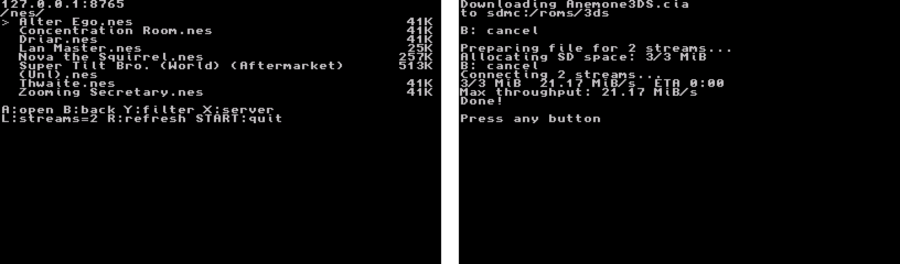

# rom-io

[](https://github.com/lhansen-dev/rom-io/actions/workflows/ci.yml)

*Pronounced "Romeo".* Browse your own ROMs and game backups from your 3DS and download them straight to the SD card over your home network.



<sub>Captured in the Azahar emulator with a local server; downloads over the 3DS's Wi-Fi are much slower.</sub>

- `server/`: a small Python HTTP server (standard library only) that serves a folder of ROMs.
- `client/`: a 3DS homebrew app (`rom-io.3dsx`) for browsing the server, downloading files, and optionally installing CIAs.
- `scripts/`: tools for preparing a ROM folder: extracting ZIPs and converting 3DS cartridge images to CIA.

rom-io doesn't include ROMs or download them from anywhere except a server you run. Use it with games you own.

## Features

- Browse folders on the 3DS, filter by name, and download with a choice of destination folder.
- Parallel downloads over up to four HTTP connections, each fetching its own range of the file.
- Downloads land as `<name>.part` and are renamed only when complete, so a failed download never replaces a good file.
- Optional CIA installation after download, with title, version, and SD space checks first.
- Scripts to extract ZIPs and convert `.3ds` cartridge images to `.cia` in bulk.

## Quick start

### 1. Run the server

Put one folder per platform in `roms/`, or point `--root` somewhere else:

```text
roms/
  gba/  Some Game (USA).gba
  snes/ ...
```

```sh
python3 server/server.py                  # serves ./roms on port 8765
python3 server/server.py --root /path/to/roms --port 9000
```

Find your computer's LAN IP (`ipconfig getifaddr en0` on macOS, `ip -4 addr` on Linux) and allow the port through your firewall if you run one.
Anyone on your network can read these files, and the server has no login.

### 2. Install the client

Download `rom-io.3dsx` from the [latest release](https://github.com/lhansen-dev/rom-io/releases/latest), or [build it yourself](#building-the-client).
Copy it to `sdmc:/3ds/` and launch it from the Homebrew Launcher.
The first time it runs, enter the server address, e.g. `192.168.1.10:8765`.

## Using the client

| Button | Action |
|---|---|
| D-pad / Circle Pad | Move |
| Left / Right | Page up / down |
| A | Open a folder or download a file |
| Y | Filter the list (every word must appear in the name, ignoring case) |
| B | Clear the filter, else go up a folder; cancel a download |
| X | Change the server |
| L | Cycle 1 → 2 → 3 → 4 download streams (starts at 2) |
| R | Refresh the folder, keeping the filter and selected entry if it still exists |
| START | Quit |

Long ROM names wrap across lines, and scrolling keeps complete entries visible.

### Downloading

When you download, rom-io asks for a destination folder (default: the last one you used) and creates it if it doesn't exist.
If the file already exists there, **A** confirms overwriting and **B** cancels.
Progress shows average speed, time remaining, and peak throughput sampled over one-second intervals.

Files of 4 GiB or larger can't fit on the FAT32 SD card and are rejected before downloading.
Trim cartridge images or convert them to smaller CIA files on your computer first.

Settings are saved to `sdmc:/3ds/rom-io/config.txt`. Line 1 is the server and line 2 is the last folder you used.

### Installing CIAs

Selecting a `.cia` offers **A: download only**, **X: download then install**, or **B: cancel**.
Installation requires access to the 3DS Application Manager under custom firmware such as Luma3DS.
Choose an absolute SD destination such as `sdmc:/cias`; the download completes before installation starts.

- The installer validates CIA metadata and available SD space, then asks for confirmation with the title ID and version.
- It supports SD applications, demos, updates, and DLC; NAND/system titles and DSiWare are rejected.
- Press **B** during installation to cancel. Interrupted reads or writes cancel the active installation, and errors show the result code.
- The downloaded CIA is kept after success, cancellation, or failure, so allow room for both the CIA and the installed contents.
- Existing-title conflicts can cause installation to fail; rom-io does not delete installed titles or tickets to make room.
- Seed-encrypted titles may need their seed imported separately with FBI before they can launch.

## Preparing ROMs

```sh
make unzip                          # extract every zip under roms/ next to itself
make cia BOOT9=/path/to/boot9.bin   # organize 3DS ROMs and create a .cia beside each
make convert                        # both, stopping if extraction fails
```

`make unzip` runs four parallel workers (`JOBS=...` to override) with a progress bar, never overwrites existing files, and deletes each zip only if it extracted cleanly.

`make cia` moves each `.3ds` under `roms/3ds/` into a folder named after the game, then converts it with a pinned version of [3dsconv](https://github.com/ihaveamac/3dsconv), installed automatically into `.tools/`.
It needs a dump of your 3DS's BootROM, found automatically in `~/.3ds/boot9.bin` or `~/.3ds/boot9_prot.bin`, and checks it against known hashes.
Original `.3ds` files are preserved, existing CIAs are skipped, and unfinished output is kept hidden and removed after failure:

```text
roms/3ds/WarioWare Gold (USA)/
  WarioWare Gold (USA).3ds
  WarioWare Gold (USA).cia
```

## How it works

**Server.** `server/server.py` extends the standard library's `SimpleHTTPRequestHandler`.
Folders are listed as plain text, one entry per line (`name/` for folders, `name<TAB>size` for files), which is simple to parse in C on the 3DS.
Files support single `Range` requests with an `ETag` built from the inode, size, and modification time.
`If-Range` falls back to the full file if it changed, and unsatisfiable ranges get a `416`.

**Parallel downloads.** For files of at least 1 MiB, the client sends a `HEAD` request, splits the file into one contiguous range per stream, and opens a connection for each.
A worker thread checks each response's status, `Content-Range`, `ETag`, and length before any of its data is used, so a file that changed since the size check is rejected rather than stitched together.
Small files, relative destinations, and servers without Range support fall back to one stream.

**Producer/consumer queues.** Each connection has a worker thread that fills a ring of four 256 KiB chunks ([`download_stream.c`](client/source/download_stream.c)), guarded by a lock and condition variable.
The main thread drains ready chunks from every stream and writes each at its own 64-bit offset in a single file, so the network and SD card stay busy at the same time and files over 2 GiB work.
Finished connections close immediately to free slots in the 3DS's HTTP service, and a download with no progress for 30 seconds is cancelled.
Single-stream downloads use the same queue with a 512 KiB SD write buffer.

**SD preallocation.** Before opening parallel connections, a worker grows the file in 32 MiB steps, so a full SD card is caught up front and ranged writes never extend the file.
It shows progress and checks for cancellation between steps.

**No half-written files.** Downloads are renamed from `.part` only after every stream delivers exactly its range.
The CIA converter writes into a hidden temporary folder and publishes with a hard link, which refuses to overwrite a CIA created by another run.

**Testing 3DS code on a computer.** The download queue and CIA installer compile against small stand-ins for the libctru calls they use ([`client/tests/`](client/tests)), with threads and locks mapped to pthreads.
The tests cover ring wrap-around, partial reads, 2–4 stream partitioning of large files, stalled connections, rejected headers, cancellation, non-ASCII paths, and every failure point in the installer.
The server tests cover listings, path traversal, ranges beyond 2 GiB, and reassembling concurrent ranges.

## Development

### Building the client

Install [devkitPro](https://devkitpro.org/wiki/Getting_Started) with the `3ds-dev` group, then:

```sh
make client                           # builds client/rom-io.3dsx
make ftp-client 3DS=192.168.1.20:5000 # builds and uploads it over FTP (open ftpd on the 3DS first)
```

CI runs both test suites and builds the client on every push.
Pushing a tag such as `v1.0.0` publishes the built `rom-io.3dsx` as a GitHub release.

### Make targets

| | |
|---|---|
| `make` / `make help` | show available targets, configuration, and examples |
| `make install` | install dependencies (Arch, with the devkitPro pacman repo) |
| `make server` | start the server (`PORT=...` to override 8765, `ROMS_DIR=...` to override `roms`) |
| `make client` | build the 3DS client |
| `make ftp-client` | build the client and FTP it to the 3DS's `/3ds/rom-io.3dsx`, replacing the old one (`3DS=ip:port` to override the default address) |
| `make unzip` | extract every zip under `roms/` next to itself (`JOBS=...` to override four workers) |
| `make convert` | run `unzip`, then `cia`; stop if extraction fails |
| `make organize-3ds` | move each `.3ds` under `roms/3ds/` into a folder named after the game |
| `make cia` | organize 3DS ROMs and create a `.cia` alongside each original (`BOOT9=...`) |
| `make install-converter` | install a pinned version of 3dsconv in `.tools/3dsconv/` |
| `make test` | server tests |
| `make test-client` | host tests for the client download queue and CIA installer (`HOST_CC=...` to override the compiler) |
| `make clean` | remove client build artifacts |

Set `PYTHON=...` to use a different Python interpreter. `ROMS_DIR=...` also controls the folder used by `make unzip` and `make cia`.

## License

[MIT](LICENSE)
